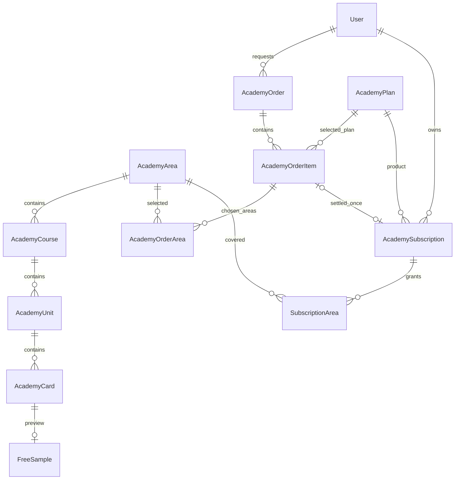

# مدل اشتراک و دسترسی آکادمی

این مدل فقط برای آکادمی است و به اشتراک ابزارهای مدیریتی وابسته نیست. قیمت، مدت و درگاه پرداخت هنوز تصمیم‌گیری نشده‌اند. ساخت درخواست خرید به‌تنهایی هیچ دسترسی پولی ایجاد نمی‌کند.

## قرارداد دسترسی

| نوع | پوشش |
| --- | --- |
| رایگان | کارت‌های فعال در `FreeSample`؛ برای مهمان و هر کاربر به‌صورت پیش‌فرض |
| عمومی | تمام درس‌ها، تمرین‌ها و مرورهای حوزهٔ `GENERAL` |
| گرایش | تمام محتوای یک یا چند گرایش انتخاب‌شده در خرید؛ اشتراک‌های متعدد با هم جمع می‌شوند |
| کامل | تمام حوزه‌ها، درس‌های عمومی، گرایش‌ها و محتوای تکمیلی فعال |

برای شروع، دو کارت اول تمام درس‌نامه‌های عمومی و دو کارت اول `S01-C1-ST01-L01` نمونه شده‌اند. این یک مقدار اولیهٔ قابل تغییر است؛ کارت‌ها و درس منتخب از مدیریت قابل انتخاب‌اند. اجرای دوبارهٔ همگام‌سازی، انتخاب‌های رایگان مدیر یا قیمت‌ها را بازنویسی نمی‌کند. حذف آخرین نمونه، رایگان‌بودن خودکار همهٔ محتوای دیگر را در پی ندارد.

`hasAccess` در API برای **همین کاربر** محاسبه می‌شود؛ روی درس یا کاربر به‌صورت بولین دائمی ذخیره نمی‌شود. `hasFullAccess` دسترسی کامل را از نمونه جدا می‌کند. `accessLevel` یکی از `full`، `sample` و `locked` است. برای هر واحد، شناسهٔ کارت‌های مجاز و تعداد اصلی کارت‌ها هم مشخص است. قفل از ترتیب پیشنهادی مسیر مستقل است.

اشتراک فعال باید شروع شده باشد، لغو نشده باشد و زمان پایانش نگذشته باشد. پوشش اشتراک‌های معتبر با هم جمع می‌شود. اشتراک متصل به خرید فقط وقتی معتبر است که سفارش پرداخت‌شده، متعلق به همان کاربر و دارای همان نوع پوشش باشد. گرایش خریداری‌شده نمی‌تواند از انتخاب‌های ثبت‌شدهٔ سفارش فراتر برود. برگشت وجه دسترسی همان خرید را متوقف می‌کند. غیرفعال‌کردن فروش یک پلن، خرید قبلی را خودکار باطل نمی‌کند؛ غیرفعال‌کردن یک حوزه، محتوای همان حوزه را از دسترس خارج می‌کند.

## ساختار دیتابیس

شناسه‌های موجود محتوا بدون تغییر به کلیدهای اصلی رجیستری تبدیل شده‌اند. متن آموزشی همچنان از منبع تأییدشده خوانده می‌شود؛ دیتابیس نسخهٔ موازی از درس‌نامه نگه نمی‌دارد. رجیستری، مرجع رابطه‌ها و انتخاب نمونه است.

هر `AcademyOrderItem` نام پلن، نوع پوشش، قیمت واحد، واحد پول و مدت را هنگام سفارش ثبت می‌کند. برای اشتراک گرایش، قیمت واحد مربوط به هر گرایش است و تعداد، از انتخاب‌های یکتای `AcademyOrderArea` به دست می‌آید. قیمت و مدت خالی به معنی تصمیم‌گیری‌نشده است؛ قیمت صفر فرض نمی‌شود.

`AcademySubscription` از پلن فعلی، پوشش مستقل ثبت‌شده و تاریخ شروع/پایان دارد. تغییر نام یا نوع پلن آینده، پوشش خرید تسویه‌شده را تغییر نمی‌دهد. `order_item` یکتا جلوی فعال‌سازی تکراری خرید را می‌گیرد. سفارش با `request_id` یکتا ثبت می‌شود؛ تکرار همان انتخاب، سفارش تازه نمی‌سازد و استفادهٔ مجدد با انتخاب یا کاربر متفاوت رد می‌شود.

فعال‌سازی دستی، دلیل و مدیر ثبت‌کننده دارد. تغییرات مدیریت در `LogEntry` جنگو ثبت می‌شوند. لغو با وضعیت `revoked` انجام می‌شود؛ برای حفظ سابقه، خریدها حذف نمی‌شوند. مسیر `fulfill_paid_order` فقط مرز داخلی اتصال آیندهٔ درگاه است؛ تا تعیین قیمت و مدت و ثبت پرداخت معتبر، دسترسی ایجاد نمی‌کند و API عمومی برای پرداخت جعلی وجود ندارد.

## انتقال و راه‌اندازی

۱. وابستگی‌ها و کد API جدید را مستقر کن و migrationها را اجرا کن.
۲. منبع `docs/learning-design` باید با نسخهٔ وب یکسان باشد. `STRATINO_ACADEMY_ROOT` را به پوشهٔ خصوصی همان نسخه بده؛ این مسیر نباید توسط وب‌سرور به‌عنوان فایل عمومی سرو شود.
۳. دستور `python manage.py sync_academy_catalog --seed-free-samples` رجیستری و مقدار اولیه را می‌سازد. گزینهٔ `--sample-cards` تعداد کارت اولیه را تغییر می‌دهد؛ مقدار پیش‌فرض دو است. بعد از شروع، نمونه‌ها را از مدیریت تغییر بده.
۴. `node scripts/prepare-academy.mjs` خروجی کنترل‌شده را فقط در `apps/api/academy-projections` می‌نویسد؛ فایل‌های قدیمی عمومی و خروجی قدیمی build پاک می‌شوند. API مستقیماً از منبع خصوصی projection می‌سازد و به این فایل‌های تولیدشده وابسته نیست.
۵. در انتشار واقعی، فایل‌های عمومی آکادمی روی CDN یا استقرار قدیمی هم باید حذف/باطل شوند. این اجرا فقط خروجی‌های محلی را پاک کرده و انتشار یا پاک‌سازی CDN بیرونی انجام نشده است.

## API و حفاظت از محتوا

- `GET /api/v1/academy/catalog/`: فهرست کامل و وضعیت دسترسی هر حوزه، مجموعه، درس‌نامه و مرور؛ بدون متن کارت‌های پولی.
- `GET /api/v1/academy/content/{unit_id}/`: متن مجاز برای همان کاربر. نمونه، سؤال، پاسخ، فعالیت، روایت و تصویر بخش پولی را دریافت نمی‌کند. واحد قفل‌شده فقط پوستهٔ معرفی می‌گیرد.
- `GET /api/v1/academy/media/{unit_id}/{filename}/`: تصویر فقط وقتی برگردانده می‌شود که به کارت مجاز همان واحد تعلق داشته باشد. نام فایل به‌تنهایی مجوز نیست.
- ذخیرهٔ پیشرفت و پاسخ‌دادن هم بررسی دسترسی دارند. نمونه به‌عنوان تکمیل کل درس علامت نمی‌خورد؛ مرور و ارزیابی به دسترسی کامل همان مجموعه نیاز دارند.
- بعد از انقضا، پاسخ‌ها و کلیدهای ارزیابی قبلی در پاسخ state فرستاده نمی‌شوند؛ یادداشت شخصی کاربر حفظ می‌شود.
- پاسخ‌های وابسته به حساب `private, no-store` هستند. شناسهٔ کارت و پرسش و کلید درست حفظ می‌شود؛ کلید ارزیابی پیش از پاسخ معتبر فرستاده نمی‌شود.
- `GET /api/v1/academy/plans/` پلن‌ها و اشتراک‌های خود کاربر را می‌دهد؛ `POST /api/v1/academy/orders/` فقط درخواست خرید را ثبت می‌کند. وضعیت `requested` به معنی پرداخت یا فعال‌سازی نیست.

## مدیریت

### قیمت و تخفیف

`AcademyPlan.price` قیمت اصلی هر پلن است؛ برای پلن گرایش، قیمت یک گرایش است. `sale_price` قیمت پس از تخفیف عمومی است و نمی‌تواند از قیمت اصلی بیشتر باشد. مقدار خالی، قیمت تعیین‌نشده را نشان می‌دهد؛ رابط برای آن عدد یا تخفیف ساختگی نمایش نمی‌دهد.

`AcademyCoupon` کد درصدی، وضعیت فعال، بازهٔ اختیاری و پلن‌های مجاز را نگه می‌دارد. انتخاب‌نکردن پلن به معنی همهٔ پلن‌های پولی است. کد هنگام ثبت به حروف بزرگ تبدیل می‌شود. در این نسخه تخفیف کد روی مبلغ پس از تخفیف عمومی اعمال می‌شود؛ محدودیت دفعات مصرف یا کد مختص کاربر هنوز تعریف نشده است.

`POST /api/v1/academy/price-quote/` با `plan_id`، `area_ids` و `coupon_code` فقط محاسبه می‌کند و سفارش یا دسترسی ایجاد نمی‌کند. تعداد گرایش‌ها، اعتبار کد، قیمت اصلی، تخفیف پلن، تخفیف کد و مبلغ نهایی روی سرور محاسبه می‌شوند. محاسبه با عدد صحیح در واحد ارز پلن انجام می‌شود؛ بخش کسری تخفیف کد رو به پایین گرد می‌شود. مبلغ ارسالی از مرورگر پذیرفته نمی‌شود. درخواست خرید دوباره روی سرور محاسبه می‌شود و قیمت اولیه، قیمت واحد، جمع، تخفیف، مبلغ نهایی و کد در `AcademyOrderItem` ثبت می‌شوند؛ تغییر بعدی قیمت و کد این سابقه را تغییر نمی‌دهد.

صفحهٔ اشتراک، کارت تصویری هر گرایش، توضیح کوتاه، قیمت اصلی خط‌خورده در صورت تخفیف واقعی، قیمت پس از تخفیف و خلاصهٔ انتخاب دارد. خلاصه در دسکتاپ کنار کارت‌ها و در موبایل زیر آن‌هاست. قیمت و مدت تجاری هنوز خالی هستند و هیچ درگاه پرداختی اضافه نشده است.

در مسیر آموزش، نداشتن اشتراک صفحهٔ جداگانهٔ قفل ایجاد نمی‌کند. فقط دایرهٔ درس بسته خاکستری و قفل‌دار است؛ لمس آن مسیر را عوض نمی‌کند و یک نوار کوچک و قابل بستن برای دیدن اشتراک‌ها نشان می‌دهد. لینک مستقیم واحد بسته هم به مسیر همان مجموعه برمی‌گردد. پایان نمونهٔ رایگان یک کارت کوتاه در همان درس دارد.

مدل‌های حوزه، مجموعه، واحد، کارت، نمونهٔ رایگان، پلن، سفارش، گرایش سفارش و اشتراک در Django Admin ثبت شده‌اند. نشانی فعلی API: `/internal/django-admin/`. ورود کاربر معمولی دسترسی مدیریت ایجاد نمی‌کند؛ حساب مدیر باید مجوزهای جنگو را داشته باشد. هیچ حسابی در این کار خودکار مدیر نشده است.

فهرست خریدها کاربر، زمان، وضعیت و گرایش‌های انتخاب‌شده را نشان می‌دهد. مدیر می‌تواند قیمت و مدت را بعداً تعیین کند، نمونه‌ها را تغییر بدهد، اشتراک دستی با دلیل بسازد یا دسترسی را لغو کند. رجیستری متن اصلی را ویرایش نمی‌کند. پنل سفارشی مدیریت و اتصال درگاه در این مرحله پیاده‌سازی نشده‌اند.

## کلید تم

کلید خورشید/ماه و حرکت دایره‌ای تغییر تم با تنظیم مرکزی ظاهر کار می‌کنند. پیش‌نمایش [Light/Dark Mode Toggle Switch اثر Joshua Christian](https://www.figma.com/community/file/1278738764813677785/light-dark-mode-toggle-switch)، با مجوز [CC BY 4.0](https://creativecommons.org/licenses/by/4.0/)، مرجع ایدهٔ روز/شب بوده است. پیاده‌سازی CSS برای این اپ ساخته شده؛ واردسازی دقیق لایه‌های فایل فیگما ادعا نمی‌شود، چون لینک Community شناسهٔ node موردنیاز ابزار را ندارد. کاهش حرکت سیستم و نبود View Transition مسیر جایگزین دارند.

نشان اشتراک از آیکن آزاد crown در Lucide گرفته شده و رنگ و قاب آن برای استراتینو تغییر کرده است. مجوز ISC کنار SVG در apps/web/src/assets/academy/LUCIDE-LICENSE.txt و داخل خود فایل حفظ شده است. الگوی استفاده از نشان تاج برای بخش‌های اشتراکی در راهنمای رسمی Canva بررسی شد: https://www.canva.dev/docs/apps/design-guidelines/premium-apps/ . فایل اختصاصی Canva کپی نشده است. کلید تم نمای ظاهری حدود ۵۲×۳۲ پیکسل و محدودهٔ لمس ۵۶×۴۴ پیکسل دارد.
