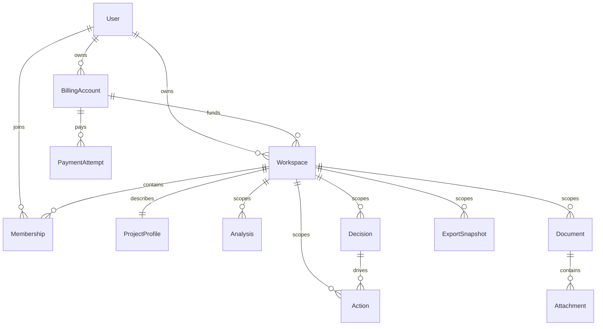

# ADR-001 — Data ownership and server contracts

Status: accepted implementation contract (STR-005), not a deployed backend.

## Entity boundaries

| Entity | Key fields and relations | Invariant |
|---|---|---|
| User | UUID, normalized unique email, framework password hash, verified_at, name, staff flags | No password/token in responses or logs |
| Preference | user FK, theme/language/motion/learning | Personal; independent of project data |
| BillingAccount | owner User FK, status | Owns entitlements; joined projects do not consume its project quota |
| Workspace | UUID, owner User FK, billing_account FK, name, archived_at, revision | Owner is authoritative; billing ownership matches |
| Membership | Workspace/User FKs, editor/viewer, unique pair | Owner role is derived from Workspace.owner_id, avoiding two competing owner fields |
| Invitation | Workspace FK, normalized email, role, hashed token, expires_at, accepted_at | Expiring, revocable and one-use; accepting does not add an owned-project quota |
| ProjectProfile | Workspace FK one-to-one, profile fields, ICP evidence, revision | A business profile never belongs to a personal account |
| Analysis | Workspace FK, kind, validated versioned input, method_version, revision | Canonical saved output is computed/validated on server |
| Decision | Workspace FK, analysis refs, reason, assumptions, review_trigger, status, revision | Linked records belong to the same Workspace |
| Action | Workspace FK, Decision FK, assignee User FK, due_at, status, revision | Assignee is owner/member of this Workspace |
| Document | Workspace FK, template_key/version, author, reviewer, draft/review/ready, revision | Template library is public content; project document/attachments are private |
| Attachment | Workspace/Document FK, opaque object key, checksum, MIME, actual bytes, scan_state | Bytes in private storage; metadata alone is not an uploaded file |
| ExportSnapshot | Workspace FK, requested_by, schema/method versions, state, object key, expiry | Scope frozen and access checked again at download |
| Plan/Entitlement | configured price/currency/limits; BillingAccount FK and effective period | Never trust frontend limits; active owned projects and stored bytes counted separately |
| Invoice/PaymentAttempt | BillingAccount FK, integer amount_rial, provider reference, idempotency key, state | Verify amount/provider server-side; callbacks cannot activate twice |
| AuditEvent | actor, Workspace optional, action, target ID, timestamp, reason | No raw documents, secrets or financial payloads in event data |

UUIDs are opaque identifiers, not authorization. Timestamps are UTC ISO-8601; local display timezone/calendar is a separate concern. API numbers remain JSON numbers and stored money uses integer rial; UI can show toman with explicit conversion. No Persian digit substitution in serialized IDs or money.

## Role and resource matrix

Owner manages project metadata, memberships, archive and billing. Editor writes analyses, decisions, actions and documents. Viewer reads and exports authorized project data. Only operator staff can manage service records; Workspace ownership never grants staff permissions. Basic export and account security are available on all plans.
Every list/detail/search/export/file operation starts from an authorized Workspace queryset. Parent IDs in route are authoritative; a client cannot change Workspace by passing it in a child payload. Validate nested relations and assigned users against that parent. Missing/non-member business resources return generic 404; unauthenticated returns 401; forbidden action within a visible Workspace returns 403. Never leak total/snippet/count from other projects.
Owner transfer (future) locks the Workspace, validates new owner/billing capacity and changes ownership atomically. An owner cannot remove their own access through member deletion. User deletion is protected while owning projects; archive is not deletion.

## Concurrency, calculations and quotas

Writes require the current revision; mismatch returns 409 with expected revision and a recoverable conflict code. Server increments revision in the same transaction. Creation and upload reservation lock the billing usage/Workspace rows so simultaneous requests cannot exceed limits. Reserve bytes, stream/scan, finalize actual bytes, then release unused reservations; retry keys prevent duplicate finalization.
Analysis kind controls a schema. EFE/IFE weights are 0–100 with total 100 within documented tolerance, rating 1–4 and complete evidence requirements for finalization. Store method_version and output snapshot; TS preview is checked against server fixtures in STR-020. No universal numeric ICP formula. Decimal financial inputs must be validated with currency/period in STR-042.
Upload is private, size/type/checksum validated and quarantined until the scan policy permits download. Prefer an authenticated gateway that rechecks membership for each new download request; the object URL/key is not returned. Direct signed URLs are a later tradeoff with explicit expiry/revocation limits, not an immediate-revocation promise. Files already downloaded cannot be recalled.

## HTTP and UX contract

OpenAPI source: docs/api/openapi.json. Session endpoint returns only authorized project summaries and staff boolean; no session token in body. Cookie authentication, CSRF on mutations, explicit CORS allowlist, no-store private responses. Each API error has a stable code, translated human detail, field errors and request ID; no stacktrace. Query limits: paginated lists, bounded search term and attachment size server-side.
UI renders saved/pending/failed/conflict distinctly. It retains safe text on validation/network errors and never claims saved from a local preview. Quota errors show actual usage and limit; retries cannot duplicate actions/payments. Closed/archive/downgrade retains authorized export and follows documented retention.

## Legacy migration and rollback

Keep old namespace and backup JSON. Import preview reports recognized schema, destination Workspace, count, rejected rows and missing attachment bytes. Stage import in a transaction/batch with idempotency; metadata for session-only file selection never becomes a fake uploaded object. Keep original backup unchanged. Undo removes only the imported batch after checking downstream edits; otherwise export/recovery is required.
DB migrations are additive first, backfill versioned fields, validate counts/checksums, switch consumers behind a feature boundary and retain a recovery snapshot. Git revert cannot reverse changed business data. Production gate is successful database AND file restore, not merely a snapshot.

## Boundaries and non-goals

One Postgres database with normalized entities and validated JSON analysis payloads. No per-Workspace databases, Kubernetes, custom auth crypto, public buckets, token storage in localStorage, or AI data transfer. Framework session security and tenant authorization are implemented and negatively tested in STR-010/012 before launch; this document does not certify them.

## Relationship map

Analysis-to-Decision links use a join table with same-Workspace validation. Attachment's redundant Workspace FK supports scoped queries; it must match Document.workspace_id. Membership's user/workspace pair is unique. Workspace.owner_id is the single source of ownership; the owner can appear in a members list without a second owner-role row. These invariants require server transaction tests, not only JSON validation.

## Schema implementation gate

`WeightedInputs` defines EFE/IFE row shape. Per-kind server registry must specify accepted `schema_version`, `method_version`, totals tolerance, incomplete draft policy and finalized evidence requirements before that kind is writable in STR-020/042. Generic `AnalysisWrite.inputs` in the envelope is deliberately not a complete validator for every calculator. An unimplemented kind/version must fail closed; never persist arbitrary input merely because the envelope passed. OpenAPI operations are planned boundaries, not a claim of complete CRUD or a live service. Each implementation extends write schemas and verifies drift before it becomes available.

`npm run check:contracts` validates OpenAPI and ownership/CSRF conventions. `npm run test:contracts` exercises synthetic positive/negative schemas. Format validation, tenant isolation, database constraints, concurrency, payment callbacks and actual uploaded bytes require server integration tests in their respective tasks. Undoing this design-only PR does not mutate any customer data.
