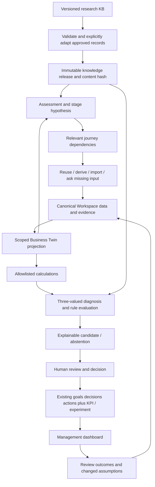

# Management OS implementation architecture

Status: accepted development proposal, 2026-10-15. Derived from [audit](AUDIT.md), actual KB contracts and existing modular monolith. This document defines intended contracts, not implemented endpoints or tables.

## Boundaries and execution

Keep React/Vite, Django, PostgreSQL and private storage. Business Twin is a **projection over canonical records**, not a graph database, giant JSON row or second source of truth. Public knowledge is immutable/versioned application content; company observations remain Workspace-scoped and never flow into the shared KB automatically.

This is a dataflow, not a mandatory waterfall across engines. Evidence quality is evaluated whenever a calculation/gate/recommendation needs it. Cache projections by Workspace, scope, input revision and knowledge release. Avoid a generic workflow DSL: small typed operators and explicit Python adapters for the approved slice suffice.

## Module and ownership map

| Canonical concept                         | Owner / reuse                                         | Scope and next change                                                                                     |
| ----------------------------------------- | ----------------------------------------------------- | --------------------------------------------------------------------------------------------------------- |
| Business                                  | existing Workspace                                    | One business context; optional BusinessUnit/venture scope later; no duplicate Business table              |
| Profile, mission, vision, business axes   | workspaces                                            | Extend profile via reviewed schema; legacy stage remains reported until assessed                          |
| Product/service, Segment, ICP             | new customer/context submodule behind profile service | Stable IDs, explicit Workspace FK; migrate embedded JSON with compatibility projection                    |
| Goal, Decision, Action                    | execution                                             | Existing normalized entities remain authoritative; profile goal JSON becomes a projection after migration |
| Competitor, Market                        | future market submodule, STR-040/051                  | Stable scoped observations and versioned provenance; not a new profile JSON copy                          |
| FrameworkAssessment                       | analysis.Analysis                                     | Existing method/input/output/revision snapshots; link KB release/method; preserve EFE/IFE versions        |
| MetricDefinition, FrameworkDefinition     | knowledge registry                                    | Public definitions; immutable releases; never Workspace facts                                             |
| MetricValue, CalculationRun               | new metrics module                                    | Definition + variant + scope + period + currency/unit + basis + value/status + input/evidence revisions   |
| Claim, Evidence, ClaimEvidenceLink        | new evidence module                                   | Claim type separate from evidence origin; supports/refutes; source record + timestamps + owner + privacy  |
| Hypothesis/Assumption                     | typed Claim                                           | Avoid redundant tables until lifecycle/query needs justify them; preserve legacy distinction and mapping  |
| ConfidenceAssessment                      | evidence                                              | Axis reasons, rule revision and reviewer; insufficient/low/medium/high, never a probability               |
| StageAssessment, maturity assessment      | management assessment service                         | Scoped provisional/supported/conflicted/unknown, evidence and expiry; headcount cannot infer stage        |
| JourneyDefinition / QuestionDefinition    | registry                                              | Explicit adapters, stable IDs, typed prerequisites and gates; research prose not executable               |
| JourneyRun / StepState / InputDisposition | management persistence                                | Definition/release pin, scope, revision, completed/deferred/skipped/blocked/unknown plus reason           |
| Answer                                    | canonical entity binding                              | Store question event/reference and provenance; do not copy revenue or ICP into answer JSON                |
| Recommendation / Insight                  | management result instances                           | Immutable input/knowledge trace, candidate/accepted/dismissed/superseded; reason and alternative evidence |
| KPI                                       | metrics + execution binding                           | Metric contract and target period/owner; distinct target vs observed value                                |
| Initiative / Experiment / Risk            | execution extensions, STR-043/065/066                 | Separate lifecycles when implemented; existing Action is not renamed into every output type               |
| DataSource / Freshness                    | evidence references                                   | Source system/record/revision, observed_at, imported_at, review_due, scope and owner; no global TTL       |
| ManagementReview                          | execution review module                               | Inputs → agenda → decisions/actions/metrics; KB cadence is a template, not a scheduler instruction        |

Cross-entity references validate same Workspace and compatible business scope in the service transaction, including nested IDs, bulk import, export and background jobs. Every write has revision conflict behavior. Viewer is read-only. Deleting membership must invalidate queries/downloads immediately. Avoid arbitrary content-type references without explicit allowed entity types and same-tenant checks.

## Knowledge release and loader

Research formats remain unchanged. STR-054 emits a production manifest containing knowledge_release, content_hash, approved record IDs, per-file research schema/shape adapter, normalized revision and source-support review. Missing schema is not silently treated as 0.1.0. Mixed 0.1.0/1.0.0 is supported only through exact adapters. Unknown enums/tags/versions fail closed for that record; unrelated approved records may still load. Planned research is never in the active registry. Deprecated IDs retain replaced_by mappings; historic runs keep their original release.

The first manifest promotes only reviewed discovery/early-traction routes, required sources/frameworks and one metric. Audit warnings are not runtime permissions. Source citation presence and claim fidelity have separate validation states. Specific activation-source concerns stay outside runtime until reviewed.

## Domain contracts

`ContextRef = workspace_id + business_unit/venture/model/segment scope + period/cohort + unit/currency + accounting_basis + input_revision`. Use explicit scope compatibility, not equality of labels. Runtime state differentiates unknown, not_applicable(with reason), invalid and observed_zero. Imports never overwrite verified values without a reviewed merge preview; contradictory aliases create conflicts, retaining originals.

`JourneyStep = id, definition_revision, domain, title_key, goal/why content, applicability, prerequisite_ids, required/optional input_bindings, question_ids, calculation_ids, framework_ids, evidence_requirements, typed completion/skip/auto_complete rules, outputs, recommendations, transitions, source_ids`. Only promoted fields become executable. Required-prerequisite DAG is separate from stage transition/review graph; return transitions are legal and bounded. Completion requires the relevant evidence/decision contract or explicit no_action, not filled-field percentage. A completed step can become stale without erasing its historical result.

`Question = id + answer_binding + why + decision_effect + applicability + ask_when + derive/import mappings + required_for_decision + skip/defer effect`. Evaluate in order: scoped canonical data → reviewed derivation → verified import → unresolved question. Existing ICP is referenced. Unverified/stale/conflicting data needs clarification, not unconditional re-entry. Every question must change a branch, calculation, diagnosis/confidence or actionable output. Guided/expert views consume the same next-input result.

`CalculationResult = metric_id + method_revision + variant + context + value_or_null + unit + status + missing_inputs + validation_errors + input_refs + explanation + sources`. Python/Decimal is authoritative for saved financial values; TS domain preview uses shared reviewed fixtures. Formulas in KB remain documentation. Allowed function registry is keyed by metric/method ID; no eval, expression execution or automatic translation from strings. For the first slice use MET-CONTRIBUTION-MARGIN (amount), explicit net_revenue and variable_costs policy. Gross-margin percent and legacy LTV/ROI are not substitutes. Other metrics, dated NPV and ambiguous IRR require separate contracts.

`EvaluationResult = matched/not_applicable/unknown + trace + missing_inputs + competing_hypotheses + input_revision + knowledge_release`. Three-valued predicates: any false makes all=false, otherwise missing/null makes unknown. Unsupported operator rejects the definition. Unknown evidence cannot satisfy a gate. Diagnostic trees propose investigation, retain several plausible branches and terminate or abstain with traversal limits; no correlation→cause shortcut. Cash interruption prioritizes a review candidate without declaring insolvency.

`RecommendationInstance = rule/diagnostic revision + metric/evidence refs + frozen input snapshot + reason + confidence axes + expected_impact(text/range with basis) + risks + alternatives + next action + sources + required_information + human_review`. Missing evidence yields a limited evidence task or abstain. Accepting a recommendation uses an idempotent transaction to create/reuse an existing Decision and Action/KPI/Experiment as applicable; do not duplicate on retry. Action currently requires Decision and due date: create a proposed Decision first, ask owner/date at acceptance, never fabricate them. No-action records require a rationale and review trigger.

## Migration and rollback

Additive migrations first. Dry-run reads every existing profile and produces deterministic old-ID → canonical-ID mapping, invalid/duplicate/conflict report and untouched source backup. Normalize products/segments/ICPs and goal ownership in small stages. Keep legacy read projection and compatibility write adapter during transition; a write has one owner, not unsynchronized dual writers. Preserve revisions/history and report/import schemas with explicit new versions. Re-run is idempotent. Rollback switches feature/read projection off and restores tested backup where needed; git revert is not database recovery. No destructive drop until parity and restore evidence pass STR-031/038.

## UX, AI and release

Reuse tokens/Vazirmatn, UI primitives, account show_tutorial/theme/language/motion, route registry and Workspace-scoped query cache. Guided mode uses quick explanation → optional learn → deep dive/source. Expert mode shows compact input, verified import, bulk/keyboard, skip/defer; knowledge and business rules are identical. Education-off hides coaching, not required validation or uncertainty. Journey scaffolds a persistent business model; the normal destination is the operating dashboard, not perpetual questionnaire completion.

Dashboard: situation, attention and next action; show unknown/stale data plainly. No arbitrary combined health score. Prefer prioritized rows with short provenance and a Why panel over a wall of metric cards. UI tasks must review design before implementation and test RTL/LTR, light/dark, reduced motion, focus, 200% zoom and 360/768/1280/1440 widths. No UI is introduced by this architecture change.

AI may summarize, explain, extract draft themes and propose alternatives with consent and review. It cannot own formula execution, permissions, deterministic branching, completion or confidence assignment. AI drafts do not mutate canonical business records automatically. STR-047 retains provider budgets/redaction/opt-in. Scenario STR-042 follows metrics foundation; parameter changes produce separate versioned runs, never overwrite observed actuals.

Progression: integrity → quality + explicit loader → canonical data/evidence/metrics → restricted vertical slice → observed validation → wider journeys/cadence/scenarios → contextual AI. Unit/contract/permission/migration tests accompany each implementation; physical/server/Compose/browser validation remains a tracked final queue per owner, and blocks acceptance/release when required.

Implementation refinement (2026-10-16): [delivery packets and packaging/service contracts](IMPLEMENTATION_GUIDE.md), [reviewed UX design](DESIGN.md), [Luna handoff](LUNA_HANDOFF.md). Current Decision source restrictions require the additive change in ADR-007 before recommendation acceptance.
