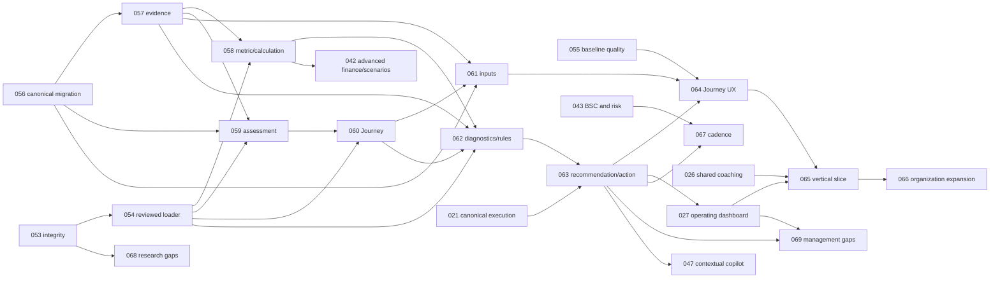

# Implementation dependency graph

Source of truth: `docs/backlog/catalog.json`; diagram shows the new critical path, not a second scheduler. Existing task dependencies and security/release gates still apply.

Order 053 → 055 → 054 → 056 → 057 → 058 is chosen to keep one coherent task at a time; 055 has its own existing STR-016 dependency. 056 also depends on existing 005/018/021. Existing import/onboarding are **inputs to** canonical migration; do not add a reverse dependency from them to 056, which would introduce a cycle. New import/onboarding adaptations happen as follow-ups under migration.

P0/P1 are development priority. Existing P0 security, backup, payments and release blockers are not downgraded by the new foundation sequence. Physical/Compose/browser queue is in NEXT_ACTIONS.md; postponed testing is not removed from the acceptance graph.
