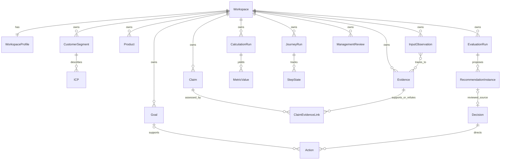

# Domain and persistence blueprint

2026-10-16. This locks initial modeling decisions. It is an implementation design, not an applied migration. Use the current Django modular monolith and PostgreSQL; no new graph database or generic entity JSON store.

## First-slice relationships

The diagram does not imply every table is introduced at once. Existing Workspace/Profile/Goal/Decision/Action remain the real owners. KnowledgeRelease/definitions are public immutable package data referenced by ID/revision/hash, not tenant ORM copies. Input/evidence linking tables and result snapshots validate explicit allowed references; no arbitrary object URL supplied by a client.

## Field ownership and normalization decisions

| Concept                         | Initial persistence decision                                                          | Migration / boundary                                                                                                                   |
| ------------------------------- | ------------------------------------------------------------------------------------- | -------------------------------------------------------------------------------------------------------------------------------------- |
| Business                        | Existing Workspace                                                                    | Do not add duplicate Business                                                                                                          |
| BusinessProfile                 | Existing WorkspaceProfile; explicit reported context and later assessed refs          | Free-text stage remains reported; do not coerce unknown tags                                                                           |
| Product/service                 | Small normalized Workspace-owned Product with kind enum when STR-056 implements it    | Preserve existing product IDs, name/description/problem/customer meaning                                                               |
| Segment                         | Normalized CustomerSegment with Workspace ownership and reviewed fields               | Never merge by label alone                                                                                                             |
| ICP                             | Stable entity linked to Segment and scoped claims                                     | Preserve legacy persona, problem, evidence and assumption provenance                                                                   |
| Goal                            | Existing execution.Goal                                                               | Profile goal JSON becomes compatibility projection; conflicts need review                                                              |
| Vision/mission                  | Explicit optional profile fields only after semantic migration review                 | Existing mission sometimes means goal/challenge in current UI; preserve raw reported meaning, never relabel automatically              |
| Competitor/Market               | Deferred normalized module under STR-040/051                                          | No second embedded Journey competitor store                                                                                            |
| Metric definition               | Approved KnowledgeRelease ID/method/variant                                           | No invented MET-* record for a raw input                                                                                               |
| Raw monetary observation        | InputObservation bound to a reviewed input binding such as net_revenue/variable_costs | Scope/period/currency/accounting policy, decimal value, source revision and evidence refs; this is not a generic arbitrary-answer blob |
| MetricValue                     | Derived approved metric result from a CalculationRun                                  | Keep value/status/unit/variant/input trace; raw revenue is not mislabeled contribution                                                 |
| FrameworkAssessment             | Existing Analysis when its method contract fits                                       | Add release/method provenance; keep existing finalized snapshots                                                                       |
| Claim / Hypothesis / Assumption | Typed Claim with claim_type                                                           | Separate from evidence origin; avoid three duplicate statement tables initially                                                        |
| Evidence                        | Scoped record with origin/method/sample/source/time/limits                            | File attachment metadata links to it only through reviewed explicit reference                                                          |
| Confidence                      | Assessment of a claim/result with axis reasons/reviewer/version                       | No sum/weights/probability; legacy confidence is reported label                                                                        |
| Answer                          | Binding/ref plus input-disposition event                                              | Do not store a second copy of canonical ICP/revenue/Goal                                                                               |
| Stage/maturity                  | Scoped assessment result with provisional/supported/conflicted/unknown                | Independent from headcount and operating trend                                                                                         |
| Journey progress                | Release-pinned JourneyRun + versioned StepState events                                | Completion is not % fields filled                                                                                                      |
| Recommendation                  | Immutable evaluated payload + audited lifecycle events                                | Depends on frozen input/evidence/release; no auto-accept                                                                               |
| Decision source                 | Add typed recommendation source per ADR-007                                           | Existing analysis/strategy sources remain valid                                                                                        |
| Initiative/Experiment/Risk      | Introduce only with their owning concrete tasks                                       | Existing Action does not become a generic universal output entity                                                                      |
| Review                          | ManagementReview plus explicit links to canonical outcomes                            | No copied Goal/Decision/Metric values as a new source of truth                                                                         |

## Minimum contracts for persistent records

All company records carry Workspace and audit timestamps. Entity IDs are stable; updates use existing positive revision pattern. Decimal observations use strings at API boundaries and Decimal server-side. Binding/definition ID, context, period, currency/unit and basis are required where meaningful. Unknown/not-applicable is represented by state plus null/reason, never a fake zero.

Claim: statement, claim_type, scope, owner, revision and lifecycle. Evidence: origin, source identity/revision, method, observed_at, optional period/sample/population/geography, limitations and review_due. Link: claim/evidence IDs, supports/refutes/qualifies, reviewer/rationale and revision. Duplicate imported source records retain identity; they cannot count as independent corroboration.

InputObservation v1 is bounded to reviewed numeric input bindings for the first calculator; do not generalize it to every question/text/file. Its binding declares value type, required context and unit constraints. Textual customer/problem answers remain in canonical context/Claim entities. Calculations reference observation IDs/revisions, not mutable field names alone.

CalculationRun and EvaluationRun freeze definition/method/release, input refs/revisions, output state, explanation and source references. Historical payload fields are immutable. New inputs create new runs. Lifecycle/status changes are separate audited events. Storage/retrieval does not reinterpret an old run through the latest KB.

## Constraints and transactional acceptance

- Every nested entity/reference must belong to the same Workspace and compatible scope. Django model clean() alone is insufficient; write/import/export/jobs use authorized services and negative tests.
- Normalize with unique `(workspace, legacy_origin, legacy_id)` mapping where applicable. Do not silently resolve duplicate names or conflicting aliases.
- Calculation identity includes metric/method/variant/context/input snapshot; current-result projection does not overwrite the run history.
- Accepting one recommendation creates at most one source-linked Decision for that accepted instance, enforced by an appropriate uniqueness constraint and idempotency key. Do not add a reverse accepted_decision FK merely to duplicate the relationship. Returned acceptance DTO can query the existing link.
- Decision source constraint extends at-most-one of analysis/strategy/recommendation. Service requires a valid reviewed source on creation. Snapshot-only historic reads remain supported, with permissions still scoped to the owning Workspace.
- Consistent lock order: authorized Workspace/current membership → canonical source/input revisions → acceptance/idempotency row → Decision/Action. Do not call external services while holding a transaction.
- Foreign IDs, viewer writes, revoked membership, stale revision and same-key/different-payload fail explicitly. Retry with the same key cannot duplicate actions.

## Migration sequence and rollback

**M0 inventory:** capture actual schema/consumer inventory, source backups and data counts. No customer changes during design.

**M1 additive schema:** create normalized context entities and stable mapping records; existing fields/routes still work. No JSON column drops.

**M2 dry-run:** derive proposed ID mappings and field meaning, report missing/duplicate/conflicting values; preserve raw payloads. Mission vs goal ambiguity requires review. Unknown is retained.

**M3 reviewed apply:** scoped transaction, idempotent mapping, one canonical write owner; compatibility read projection emits old DTOs and explicit schema versions for imports/exports. Never leave independent old/new writers.

**M4 parity and rollback proof:** profile/ICP/goals, action links, exports, histories and permissions match expected records. Re-run applies no duplicate records. Backups/restore and compatibility route rollback are tested on PostgreSQL in the final validation queue.

**M5 retire:** only a later approved migration removes legacy write/columns after real parity and recovery evidence. Reverting code alone is not data recovery.

## Architectural decisions retained for stronger review

Luna must not independently change entity ownership, tenant boundaries, source discriminator, confidence formula, input meaning, stage criteria, financial method, migration deletion or first-slice scope. If a packet encounters a contradiction with this blueprint or KB, record exact evidence and defer that decision for architecture review; continue an independent small packet. Do not “simplify” by bypassing a source, copying a company value or treating unknown as success.
