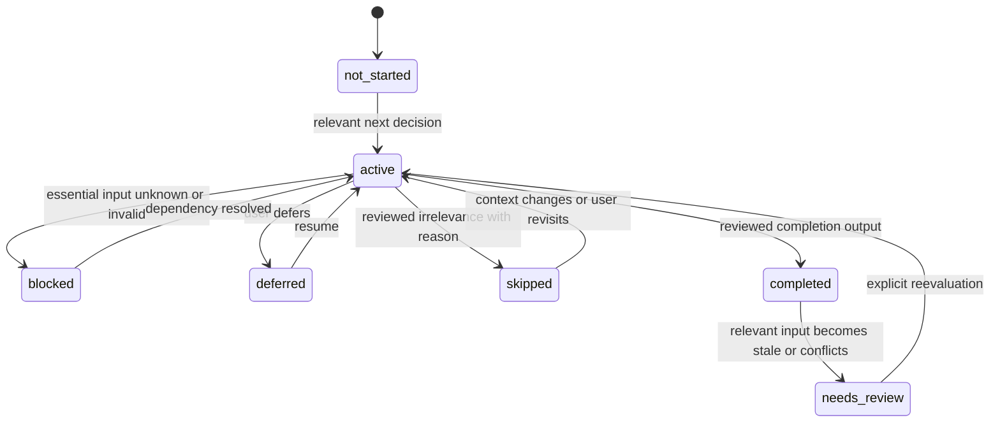
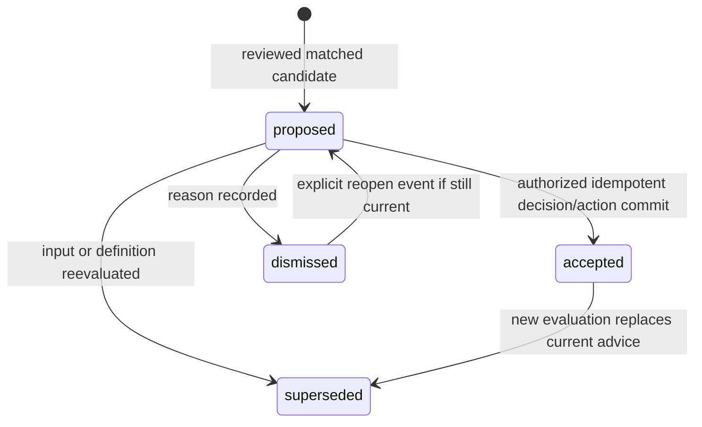

# State, revision and invalidation model

2026-10-16. Initial architecture contract for implementation, not new production events or queues.

## Journey state

Skip/irrelevance is not a completed business gate. A completed event keeps its original release/input snapshot; needs_review is a new current state/event, not a rewrite of the historical result. Applicable dependencies are computed from the reviewed definition/context, not from route order. Stage transitions may return to discovery; prerequisite cycles remain invalid.

## Evaluation and candidate lifecycle

Evaluation result is matched / not_applicable / unknown / definition_error, separate from candidate lifecycle. Unknown can yield a reviewed bounded evidence-collection candidate, never a fabricated causal verdict. Definition error disables the affected route and preserves other existing tools.

Superseding advice does not cancel an accepted Decision/Action silently. The manager reviews its implications in execution. Reopening an already accepted instance resolves to its linked records rather than creating another acceptance. Lifecycle fields/events are mutable under revision; evaluated payload fields remain immutable.

## Events and projections

Use transactional service events/audit records first; no external broker/Redis/Celery is required. Existing execution events remain authoritative for their entities.

| Trigger                                     | Immutable history                                          | Current projections invalidated                                                | User-facing result                                              |
| ------------------------------------------- | ---------------------------------------------------------- | ------------------------------------------------------------------------------ | --------------------------------------------------------------- |
| Canonical profile/ICP edit                  | Prior revision + change actor/time                         | Same Workspace/scope assessment and dependent input plan                       | Existing value updated; affected advice may need review         |
| Numeric observation edit                    | Prior observation/run revisions                            | Affected metric calculation/current-result projection and dependent evaluation | New result or explicit unknown/invalid; old report stays frozen |
| Evidence review/refutation/freshness change | Evidence/link/review event                                 | Dependent confidence, step/gate and recommendations                            | Changed certainty/review need with reason                       |
| New knowledge release                       | Prior release remains available                            | New evaluation candidates only; never mutate historic runs                     | Existing accepted explanation retains old definition            |
| Recommendation accepted                     | Acceptance key/payload + Decision/Action/audit transaction | Recommendation state, execution board, overview                                | One consistent saved commitment                                 |
| Action status/due/owner edit                | Existing execution event                                   | Execution and overview/review projections                                      | Actual commitment status, not an inferred business outcome      |
| Workspace switch                            | No company-data mutation                                   | Clear old scoped queries/drafts per guard, load new context                    | Visible new Workspace, no stale data flash                      |
| Membership revoked                          | Membership/audit event                                     | All client private Workspace projections and future server authorization       | No further page/export/file access                              |
| Import reviewed/applied                     | Source backup, mapping, conflicts and canonical revisions  | Only affected contexts/resources                                               | Recoverable result, no silent merge                             |

Freshness is evaluated at the relevant read/evaluation time against review_due/context, with an explicit assessed_at. Do not require a background worker solely to mark a row stale. Future reminders require the existing notification task's opt-in and idempotency contract.

## Query and concurrency decisions

Queries carry Workspace + explicit scope + resource/run/release identity as needed. Request bodies cannot select the owning Workspace. Current projections can be cached by input revision/release; old result/detail keys remain immutable. Invalidation cannot promote a different Workspace's record with the same label.

Calculation/evaluation on a captured snapshot may complete even if data changes, but its response must state the captured revision. Accepting it checks current eligible revision and permissions; stale results require reviewed reevaluation or an explicit recorded override contract. No blind last-write-wins. Owner/date/source acceptance and duplicate-key handling live in one transaction; no external call while locks are held.

Exports pin selected results and content versions. Deleting/changing live data does not reinterpret a prior snapshot, subject to retention/erasure policy. Do not keep unauthorized private client caches to simulate offline continuity. Session recovery reauthorizes before revealing a preserved draft.
